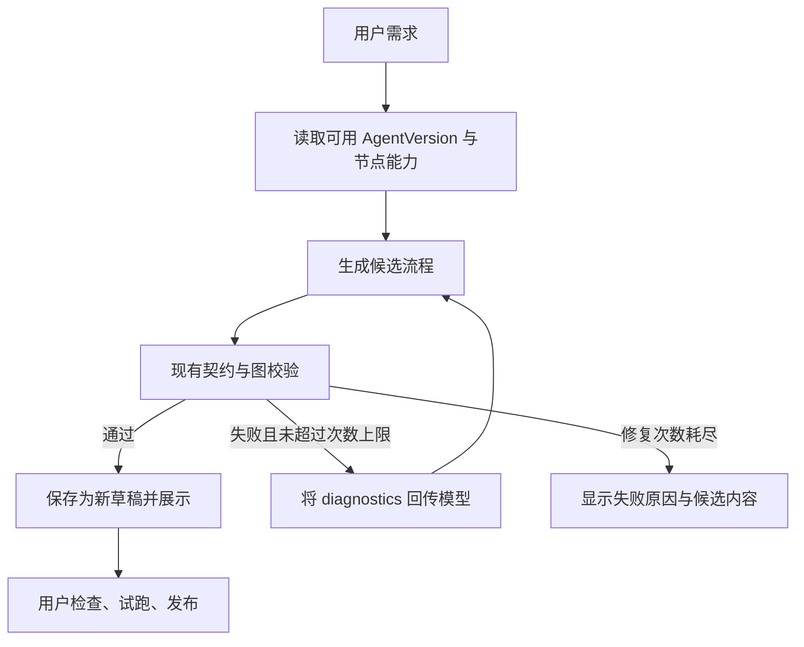

# Orbit 开发路线

> 更新：2026-11-25。阶段 A 已完成本地模式的业务验收；后续阶段仍按各自标准推进。

## 1. 我们要做的产品

**一个多 Agent 工作台：把职责明确、可配置、可测试的 Agent 组合成 SOP，最终由主 Agent 根据一句话需求生成配置与流程草稿。**

用户最终可以说：

> 示例需求：“把这段英文资料翻译成中文，检查术语和遗漏，最后整理成报告。”

工作台帮助用户选择或创建三个 Agent，配置模型和能力，连接数据，展示可检查的流程，试跑后再发布。


这是产品推进顺序。手动编排已有基础实现，后续工作应复用它；不能把图中的每一步都理解为从零开发。

## 2. 之前已经确定的取舍

| 决策 | 开发时怎样执行 |
| --- | --- |
| 先把单 Agent 做可靠，再做组合和自动编排 | 每个 Agent 先独立试跑，再纳入 SOP 综合验收 |
| 保留核心功能，持续精简 | 保留 Agent、对话、技能与 SOP；不恢复历史 PRD、OpenSpec 流程和无用包装层 |
| 复用 Mastra 的框架能力 | 模型协议、Agent 推理与工具循环、MCP、Workflow、Memory 使用框架；Orbit 管配置、权限、版本和产品体验 |
| 模型配置集中复用 | 接口格式、模型 ID、地址和密钥在模型配置中管理；Agent 保存连接引用 |
| 配置界面清楚分层 | 常用配置直接展示，权限和输出等高级配置按用途收拢；不将所有字段堆在同一层 |
| 先理清依赖，再做功能回归 | Web → BFF → Runtime Ports → Mastra；共享契约放 packages，框架细节留在 Agent 适配层 |
| 保持小步交付 | 一个明确目标 → 实现与回归 → 人工验收；不为开发路线额外引入繁重流程 |

**建议继续采用的设计方向：主 Agent 先在规划阶段生成可检查的草稿，运行阶段执行固定版本的流程。** 这承接此前讨论，但自然语言编排尚未实现。运行时自由派发、动态 handoff 留到后续单独验证。

## 3. 当前到了哪里

| 领域 | 当前实现 | 仍需推进 |
| --- | --- | --- |
| Agent 卡片 | 创建、编辑；职责、模型、工具白名单、技能与输出配置 | 用实际任务确认配置行为，积累可重复的验收用例 |
| 独立试跑 | 测已保存草稿或发布版本；配置身份、历史记录、取消、错误与结构化结果展示 | 批量用例、质量评估与版本对比，按实际需求逐步补齐 |
| 版本 | 从保存的配置生成不可变版本；SOP 可绑定固定版本 | 验证改草稿、改模型连接后，既有 SOP 仍使用原绑定 |
| 模型 | Mastra 内置解析；OpenAI 兼容、Anthropic Messages、Google Gemini；连接增改、软删除与恢复 | 针对可用账户做真实调用验证；协议支持不等于账户、额度和工具能力可用 |
| CLI 与卡片 | 共用 Mastra 执行路径；显式 Agent 职责与工具策略已有隔离处理 | 每次调整公共 Runtime 时继续做交叉回归 |
| 手动 SOP | Agent 节点、输入绑定、图校验、运行、节点事件、暂停与恢复等基础 | 让用户容易连接、排查并重复验证多个不同 Agent |
| 多 Agent 协作 | 有三 Agent 串行交接及输出校验的自动化测试 | 该测试模拟模型运行端口；还需要浏览器操作与真实模型的业务验收 |
| 异构并行 | Parallel/Merge 代码存在，`parallelMerge` 产品能力仍关闭 | 评估 collect 能否独立开放；不能把“代码存在”当成可用能力 |
| 一句话编排 | 本次未找到完整生成、诊断回灌和落草稿的产品入口 | 在手动协作闭环稳定后建设 |
| SaaS | 已有身份入口、个人配置隔离，以及 SOP / AgentVersion 租户存储基础 | 核心业务 API 尚未开放完整 SaaS 能力，不能视为多租户工作台已完成 |

旧讨论中的“Agent 运行字段全部硬编码”“没有发布入口”等结论已过时。现在模型、工具权限和输出格式来自 Agent 配置，发布与试跑也已有入口，不应重复建设。

## 4. 接下来按这个顺序推进

### 阶段 A：完成单 Agent 的业务验收

**目标：用户填的配置，确实决定 Agent 的行为。** 当前重点是验证和补缺陷。

用同一条“翻译 → 审校 → 报告”案例，分别建立三个职责不同的 Agent。先使用默认文本输出；需要字段交接时再设置高级输出格式，避免一开始增加操作负担。

- [x] 翻译 Agent：只按职责翻译，不回答默认“介绍自己”的试跑任务。
- [x] 审校 Agent：检查译文，返回问题与修改建议。
- [x] 报告 Agent：根据译文和审校结果生成报告。
- [x] 确认未保存修改会阻止草稿试跑；切换配置、试跑和版本页不丢输入。
- [x] 验证允许与未授权工具的真实执行差异、技能指令生效及输出格式错误。
- [x] 发布 v1，修改草稿与模型连接，重新试跑 v1，确认仍使用旧配置。
- [x] 覆盖无模型、无效密钥、额度不足、超时和取消，页面给出可理解的结果。

**完成标准：** 三个 Agent 都有可追溯的独立试跑记录；记录能对应输入、固定配置和结果。确定性行为用断言验证，翻译质量按明确标准人工检查；不要求模型逐字一致。

**本轮验收记录（2026-11-25）：** 使用隔离本地工作区与现有 `deepseek-flash` 连接，没有修改用户原始 Agent 和模型配置。

| 独立任务 | 实际检查 | 运行 ID |
| --- | --- | --- |
| 翻译 | 保留 Orbit、120、12%、2025；没有自我介绍 | c1eff75a-68d0-4a08-9774-a3da1b58f54c |
| 审校 | 指出 120 被误译为 12，给出修订建议 | 0ca5da65-6990-4a86-9918-fe45b6c1b5b4 |
| 报告 | 结合译文和审校生成摘要、问题、建议，并指出输入版本不一致 | 3fcf6e5c-1001-4dcd-a531-e2ae8c3c0da5 |
| 固定 v1 | 修改草稿职责与连接修订后，v1 仍使用原模型引用和哈希，保持翻译职责 | 6157f08c-daf7-4e68-92b1-0ba13b44e76c |

确定性回归使用真实 Mastra、SDK 和工具执行，仅模拟模型 HTTP：验证技能注入、授权工具执行一次/未授权不暴露工具、输出 schema 错误、无效密钥、额度不足、超时、父子取消与后续恢复。浏览器验证空输入、未保存拦截、切页保留、历史追溯、缺模型提示和 785px 窄屏。真实模型只验收业务质量与版本固定；没有故意消耗账户额度制造限额错误。

本轮补缺陷：移除强制写入的试跑默认任务；Web 保存携带 revision，冲突返回 409 并保留本地编辑；解释常见模型错误；取消接口返回完成后的快照，防止旧响应、SSE 回放与旧查询把终态改回运行中。测试数据在清理前保存去敏证据到 `/tmp/orbit-stage-a-acceptance.json` 与 `/tmp/orbit-stage-a-*.jpg`；隔离工作区及凭据副本已删除，仓库不纳入运行数据。

本轮验证通过：`pnpm build`；Web 190 项、BFF 104 项、Agent 575 项、workflow-core 54 项；`pnpm check:structure`、`pnpm check:workflow-boundaries` 和 `git diff --check`。BFF controller 测试在清理连接后又单独通过。阶段 A 本地模式暂无阻塞项；多模型全供应商真实质量与多租户业务开放不属于本轮完成范围。

### 阶段 B：打通手动多 Agent SOP 的真实闭环

**目标：用户可以把已验证的 Agent 接起来，清楚看到交接和失败位置。**

以下是待验收的产品案例，字段与内容是示例：


图中的两条报告输入表示数据依赖，不表示已开放 Parallel/Merge；首个版本仍按翻译、审校、报告的顺序执行。

- [ ] 在画布中选择三个已发布 AgentVersion，完成输入绑定并运行。
- [ ] 报告 Agent 同时拿到译文和审校结果，不能靠用户再次复制粘贴交接。
- [ ] 明确显示每个节点使用的 Agent 版本、输入、输出、耗时和错误。
- [ ] 检查结构化字段选择与发布校验；字段写错时尽量在运行前指出。
- [ ] 将某个 Agent 改为不符合输出格式，确认失败定位到该节点且下游行为明确。
- [ ] 验证父流程取消会传播到活动 Agent，刷新后能继续查看运行结果。
- [ ] SOP 发布后修改 Agent 草稿，确认流程仍绑定原版本。

**完成标准：** 从 UI 创建并运行一个三 Agent SOP，成功和失败路径都能解释；本地模拟回归与真实模型验收分开记录。

**建议下一轮先做这个具体增量：** 检查现有 Agent 节点的字段绑定和结果展示，完成上述三 Agent 示例；只补阻塞闭环的缺口，不重写画布和调度器。若阶段 A 尚有失败项，先修复再继续。

### 阶段 C：完善协作能力与稳定性

**目标：在串行闭环可靠后，增加真正有用途的组合形状。**

1. 条件分支：例如审校无问题直接出报告，有问题走修订节点；明确输入和分支结果。
2. 输出可靠性：评估通过 Mastra 下发结构化输出约束的可行性，保留运行后的 schema 校验；当前实现主要是提示词约束加事后校验，不应承诺所有模型都有原生结构化输出。
3. 异构并行：先用证据测试确认 collect 模式的错误收集、取消、事件和恢复语义，再决定是否拆分 capability；fail-fast 的 sibling 取消缺口未解决前保持关闭。
4. 运行观测：围绕实际排错需要补运行详情、版本对照和资源统计；上游未返回 token 用量时显示未知，不能当作零消耗。

**完成标准：** 每新增一种协作方式，都有对应成功、失败、取消及必要的恢复用例；不能绕过现有发布门禁。

### 阶段 D：一句话生成 SOP 草稿

**目标：主 Agent 把需求转换成用户能检查和编辑的流程。**



首版范围：复用已有 Agent 发布版本；先支持 start、agent、end，再按需要加 condition。候选数据经受控转换落为标准 WorkflowDraft，所有引用和图结构都必须经过现有校验。

- [ ] 只向主 Agent 提供可访问的配置摘要、节点规范与版本信息，不传 API Key。
- [ ] 生成节点、连线和输入映射；缺失必要能力时明确指出，不能编造 AgentVersion ID。
- [ ] 有限次诊断回灌；失败必须可见，候选内容不能标成可运行流程。
- [ ] 默认创建新草稿，不覆盖既有流程，不自动发布或调用业务工具。
- [ ] 给用户展示选择这些 Agent 的理由、待补配置和验证结果。

**完成标准：** 针对一组固定需求，生成的流程能通过校验、可在画布修改、可试跑；失败场景也可理解。

### 阶段 E：主 Agent 帮助创建和配置 Agent

**目标：目录缺少合适 Agent 时，主 Agent 能提议并生成 Agent 草稿，再组合成 SOP。**

扩展阶段 D：输出职责、建议模型引用、最小工具权限、技能建议和输出契约；先让用户审阅草稿，完成独立试跑与发布，再将固定版本绑定进 SOP。凭据由用户通过现有模型配置入口提供。

**完成标准：** 从一句话需求走到 Agent 草稿、独立测试、版本和 SOP 草稿的可追溯闭环；用户能调整每一步。运行时自主 handoff、动态创建子任务与长期团队协作另立后续目标，不直接混入首版自动编排。

## 5. SaaS 上线支线：与产品闭环分开验收

仓库最近新增的身份与租户改造属于上线基础。它不改变多 Agent 工作台的目标，但决定哪些能力可以向外部用户开放。

当前 SaaS 模式仅开放已隔离的身份与个人配置接口；其余业务接口仍受门禁限制。SOP 和 AgentVersion 的存储隔离完成，不代表对应 API 与执行链已经全程隔离。

后续按依赖推进：AgentProfile 与 WorkflowRun 归属 → 跨存储引用 → Runtime / Memory / SSE / 审计归属 → 模型凭据、工具工作目录及技能资源隔离。每个领域验证越权访问后，再逐项开放 API；细节以 [SaaS 身份说明](saas-identity.md) 为准。

如果当前迭代以对外 SaaS 为交付目标，应优先完成它所依赖的隔离工作；本地模式可以继续验证阶段 A、B。不要为演示业务闭环临时放开 SaaS 门禁。

## 6. 开发时从哪里进入

| 要改的内容 | 入口 |
| --- | --- |
| Agent 配置与试跑 UI | [Agent 功能目录](../apps/web-console/src/features/agents/) |
| 模型配置 UI | [设置组件](../apps/web-console/src/features/settings/components/) |
| Agent 快照、发布与独立试跑 | [AgentVersionService](../apps/bff/src/agents/agent-version.service.ts)、[AgentWorkbenchService](../apps/bff/src/agents/agent-workbench.service.ts) |
| 共享 Agent 配置和输出契约 | [agent-configuration.ts](../packages/workflow-core/src/contracts/agent-configuration.ts) |
| 模型连接与 Mastra 解析 | [mastra/models](../apps/agent-cli/src/mastra/models/)、[ModelConnectionStore](../apps/agent-cli/src/services/model-connection-store.ts) |
| SOP 编辑与绑定交互 | [SOP 功能目录](../apps/web-console/src/features/sop/) |
| Agent 节点执行及输出校验 | [agent-node-executor.ts](../apps/agent-cli/src/mastra/workflows/agent-node-executor.ts) |
| 图发布校验与导入预览 | [publish.ts](../packages/workflow-core/src/validation/publish.ts)、[SOP 服务目录](../apps/bff/src/sops/) |
| 单 Agent 与三 Agent 组合回归 | [agent-workbench-runtime.test.ts](../apps/agent-cli/test/smoke/agent-workbench-runtime.test.ts) |
| CLI 与模型协议回归 | [cli-mastra-runtime.test.ts](../apps/agent-cli/test/smoke/cli-mastra-runtime.test.ts)、[multi-model-runtime.test.ts](../apps/agent-cli/test/smoke/multi-model-runtime.test.ts) |

自动编排未来的业务入口应归 BFF 的 SOP 领域；生成请求与结果契约复用共享包，模型执行留在 Runtime / Mastra 边界。出现真实复杂度再拆文件，不先铺空目录。

## 7. 每轮开发的完成条件

1. 选一个明确目标，说明输入、用户可见结果和失败行为。
2. 行为变化先补能复现问题的回归，再实现；纯文档调整只检查内容和链接。
3. 执行 `pnpm build`、对应单元测试与 smoke；跨公共 Runtime 的改动扩大回归范围。
4. 涉及模型时，区分本地模拟协议测试与真实云端调用；真实调用消耗账户额度，结果记录模型和配置身份。
5. UI 变化检查正常、空态、错误和窄屏；清理本轮测试数据，保留用户配置。
6. 更新本文的阶段状态与验收勾选，汇报证据和未解决问题，等待用户验收后提交。

常用验证命令：

```bash
pnpm build
pnpm --filter agent-web-console test
pnpm --filter agent-bff test
pnpm --filter agent-cli test:models
pnpm --filter agent-cli exec vitest run test/smoke/agent-workbench-runtime.test.ts --no-cache
pnpm check:structure
pnpm check:workflow-boundaries
# 发布前或公共边界大幅变化时执行全仓回归
pnpm test
```

本文只维护当前路线。目录职责见 [架构说明](architecture.md)，启动和配置见 [README](../README.md)，开发约束以 [AGENTS.md](../AGENTS.md) 为准。
