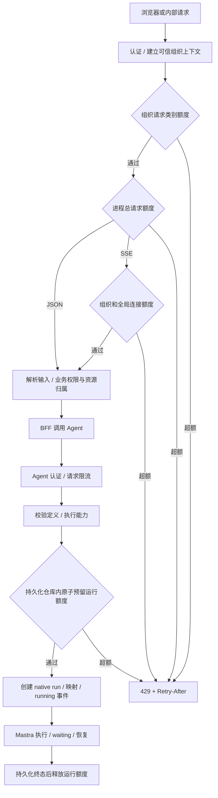

# 组织运行配额、请求限流与连接治理

更新：2026-11-26。对应 M1-C 第三批。当前部署边界为单 BFF、单 Agent 进程，Agent 独占自己的运行目录；本页的限值是首期保护默认值，不是经生产负载测试得到的容量承诺。

## 三种限制解决不同问题

例如组织 A 有五个运行正在等待审批。它们没有持续执行模型调用，但仍占用快照、运行索引和恢复资源。如果暂停就释放组织容量，A 可以无限创建 waiting 运行。另一方面，B 每秒查询几百次，未必增加运行数量，却会消耗 HTTP、数据库读取和投影计算资源。SSE 只有一次请求，但连接可以保持很久，也要单独计数。

| 保护对象 | 当前策略 | 释放或恢复条件 |
| --- | --- | --- |
| 未完成运行 | 每组织 5 个，Agent 总计 50 个 | 运行持久化进入 succeeded、failed 或 cancelled |
| 请求频率 | 按可信组织和请求类别限制固定窗口内次数 | 窗口到期；进程重启重新计数 |
| SSE 长连接 | 每组织 8 条，进程总计 128 条 | HTTP 响应结束或连接关闭 |

“每组织”使用可信 `issuer + tenantId` 派生的哈希键，成员共享额度。换 subject、伪造 `X-Forwarded-For` 或更换客户端 IP 不能获得新额度；不同 issuer 的相同组织 ID 不碰撞。BFF 和 Agent 各自计数，不把两个进程的额度相加作为允许的请求量。

## 一次请求如何经过这些边界

SaaS 浏览器业务白名单仍关闭，不能因限流已实现而扩大开放范围。限流在可信身份之后、JSON 解析器之前执行；未登录、OIDC 协议端点及被能力白名单提前拒绝的流量不经过组织计数，需要入口代理另外保护。直接调用 service 不经过 HTTP 频率限制，但 Runtime 的运行仓库仍会检查运行额度。

## 运行额度怎样防并发绕过

[运行仓库](../apps/agent-cli/src/mastra/storage/workflow-run-repository.ts) 在同一串行更新中读取未完成记录、计算全局/当前组织数量并插入新记录。“先查数量，再异步插入”会让多个请求看到同一个剩余额度，不能用于准入。

运行创建完成前先预留产品记录，通过后才创建原生运行、产品/native 映射和首条事件。准备阶段抛错会撤销该预留，不执行工作流节点。超额不创建运行记录或映射，也不占用该运行 ID。已经创建的运行恢复时复用原来的容量，不重复申请；审批幂等继续由原有回执保证。

waiting 计入未完成额度，重启从产品记录恢复计数。进程崩溃留下的 running 记录也保守计入，不能只因重启就自动释放。它们需要恢复、明确失败或通过已有取消入口结束；本轮没有添加 Worker 接管或自动对账。磁盘写入失败、损坏或空 JSON 文件明确报错，不能解释为空仓库后放行。JSON 文件用临时文件加 rename 替换，避免先删除旧记录造成空窗；这不等同于断电级持久性保证。

当前 50 个总容量也包含本地未完成运行；每组织 5 个限制仅用于带可信组织归属的记录。本地无身份 HTTP 请求不经过组织请求限流，生产仍强制 SaaS 与服务认证。

## 请求频率复用成熟组件

[HTTP 配额工厂](../packages/service-auth/src/tenant-http-limits.ts) 复用 `express-rate-limit@8.6.0` 的 `MemoryStore`、固定窗口计数、标准限流响应头及失败处理。`@orbit/service-auth/http` 独立导出 HTTP 能力，普通身份/配额错误类型不加载 Express 中间件。

| 请求类别 | 每组织每 60 秒 | 包含范围 |
| --- | --- | --- |
| 读取 | 300 | GET / HEAD，SSE 建连也计一次 |
| 写入 | 60 | 默认 POST / PUT / PATCH / DELETE，例如草稿编辑、导入和发布 |
| 启动 | 20 | POST Workflow 运行入口 |
| 控制 | 60 | POST run cancel / resume，取消与审批共享 |
| 进程总请求 | 2,000 | 已通过组织类别限制的可信租户 HTTP 请求 |

先检查组织额度，再检查进程总额度。已被组织限流拒绝的请求不消耗总额度，避免一个组织反复发送超额请求就耗尽其他组织的全局容量。读取、写入、启动、控制分别计数，启动请求过多不会耗尽取消或审批的类别额度。全局额度仍是共享的最后保护，耗尽时所有组织都可能暂时被拒绝，不代表已建立公平排队。

即使请求后续业务权限不足、参数无效或运行容量已满，也会占用已经通过的 HTTP 类别计数，防止恶意失败请求免费反复执行校验。URL 大小写和尾斜杠归一化后分类，SSE 不可通过改写路径逃过连接计数。限流组件不会接受客户端提交的额度、组织标识或重置指令。

固定窗口可能在相邻窗口边界产生短时突发；它不是滑动窗口，不替代反向代理读取超时、连接数、未认证流量或网络带宽控制。`MemoryStore` 每进程独立且重启清零；多副本上线前必须换成受支持的共享 Store，并重新验证额度和故障行为。

## SSE 不能只限请求次数

通过频率限制后，再同步预留组织/全局连接槽位。监听 `finish` 和 `close`，使用同一个幂等释放函数，避免两个事件各减一次。容量超限在发送 SSE 响应头前返回 JSON 429，不占槽位。

HTTP 断开会通过共享 `WorkflowRuntimeEventQuery.signal` 取消订阅，唤醒挂起的事件队列并移除 journal listener。**取消订阅不取消运行**；等待审批的运行继续占运行额度。服务关闭或上游出错同样释放连接槽位。SSE 重连需要重新通过请求及连接额度，客户端应遵守退避时间。

## 客户端如何处理拒绝

| 错误码 | HTTP | Retry-After | 含义 |
| --- | --- | --- | --- |
| `WORKFLOW_CONCURRENCY_LIMIT` | 429 | 60 秒 | 当前组织未完成运行已满 |
| `WORKFLOW_CAPACITY_LIMIT` | 429 | 60 秒 | Agent 未完成运行总容量已满 |
| `TENANT_REQUEST_RATE_LIMIT` | 429 | 由组件给出的窗口剩余秒数 | HTTP 请求类别或进程总额度已满 |
| `TENANT_STREAM_LIMIT` | 429 | 5 秒 | 组织或进程 SSE 连接已满 |

Retry-After 表示建议最早重试间隔，不承诺到时一定有空位。容量满时应先查看、完成或取消已有运行，避免立即循环重试。BFF 保留 Agent 的 429 错误和经校验的 Retry-After；不把拒绝误判成已接受运行失败，不保存伪造运行快照。

## 审计与这批限制的边界

创建、保存、删除、导入、版本派生、模板保存/删除及模板派生使用 `workflow.edit` 审计，detail 仅记录固定 mutation 名称。成功结果审计和 SQLite 业务写入处于同一事务，审计写入失败时回滚业务数据；requested 和 failed 保留在事务外用于排查。缺少权限或参数校验提前失败不会新增写入审计，数据库修订冲突会记录失败。见 [组织权限与审计语义](organization-authorization.md)。

HTTP 限流拒绝不会每次都写审计，避免拒绝流量放大数据库；已进入控制审计后才被 Agent 容量拒绝的启动请求会记录 failed。审计总存储、保留期和归档仍属于后续治理，不宣称本轮限制了数据库总容量。

本轮不实现分布式锁、共享限流存储、队列、公平调度或崩溃任务自动回收。多个 Agent 不得共用当前 JSON 运行目录，多个 BFF 也不能依靠独立内存计数获得全局配额。总存储、CPU/内存、模型费用和工具副作用有各自的隔离要求，见后续 M2–M6。

## 验证入口

- [共享 HTTP 回归](../packages/service-auth/test/unit/tenant-http-limits.test.ts)：并行请求、成员/IP 变化、issuer、窗口到期、类别独立、单组织拒绝不耗全局、全局请求/SSE 上限、断线释放。
- [运行仓库回归](../apps/agent-cli/test/unit/mastra/storage/workflow-run-repository.test.ts)：并发原子准入、waiting、重建、终态释放、全局容量。
- [Runtime 回归](../apps/agent-cli/test/unit/mastra/adapters/workflow-runtime-adapter.test.ts)：启动准备失败撤销预留、取消订阅移除 listener、不影响运行。
- [JSON 仓库回归](../apps/agent-cli/test/unit/mastra/storage/json-file-repository.test.ts)：读取故障不能缓存为空、损坏文件拒绝、首次创建与重新读取。
- [真实 Agent 进程 smoke](../apps/bff/test/smoke/runtime-tenant-boundary.test.ts)：HTTP 429、waiting/重启容量、取消释放、HTTP 频率限制、SSE 满额与断线恢复，不调用收费模型。
- [草稿审计回归](../apps/bff/test/unit/sops/sops-authorization.test.ts)：完整写入路径、可信操作人、脱敏、修订冲突、审计故障回滚。

这些回归不替代真实 OIDC → BFF 业务 → Agent 的完整入口验收，也不替代生产容量测试。
