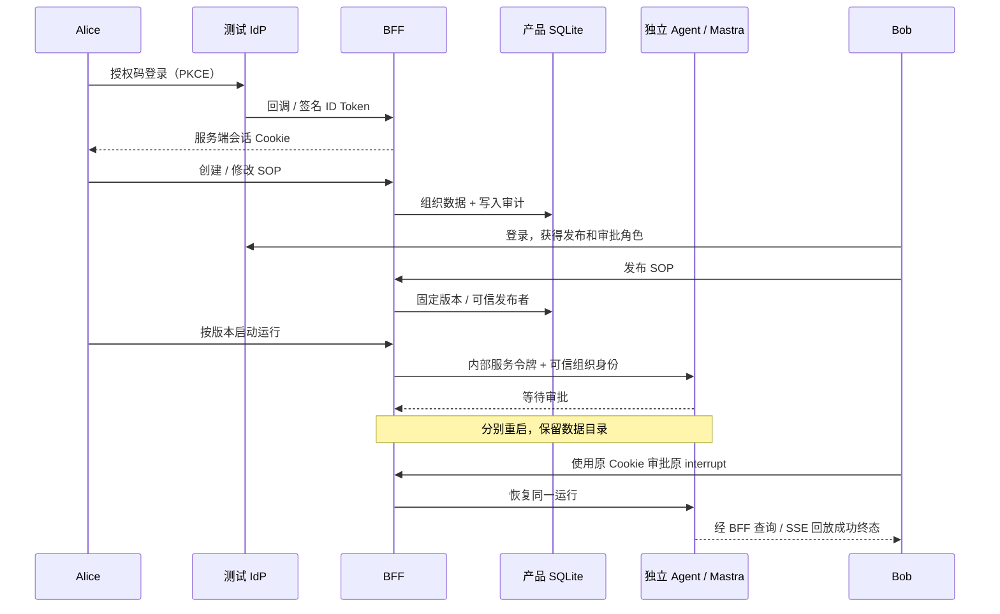

# M1-D：从登录到 Workflow 执行的完整入口

更新：2026-11-28。已完成测试 IdP、真实 BFF、产品 SQLite 和独立 Agent/Mastra 的 HTTP 集成回归；第二批增加活动 SSE 持续授权，以及真实 Keycloak 26.4.7、HTTPS 代理与生产模式配置下的独立验收。实际部署域名、证书、网络和容量仍需在目标环境验收。

## 这次串起来的链路

原来的测试分别证明登录正确、业务授权正确、Agent 隔离正确。本轮使用真实授权码回调建立 Cookie，之后请求全部经过生产 BFF 装配；没有通过测试 header 注入身份，也没有 mock Workflow Runtime。



回归覆盖：匿名 401、跨源写入 403、可信发布者与发起人、禁止自审批、角色不足、组织切换、跨组织资源 404、重复审批与相反决定冲突、取消权限、SSE 断线及 Last-Event-ID 回放、BFF/Agent 重启、本地和签名后通道注销后的旧 Cookie 失效。数据库检查确认组织与发起人持久化，审计不包含审批正文。

## 显式启用受限入口

新增服务端配置：

```dotenv
BFF_SAAS_WORKFLOW_ACCESS=disabled
```

默认 `disabled`，延续身份、个人资料和设置的现有开放范围。自动集成测试显式设置 `restricted`；预发布环境也可用该值联调。错误值在创建数据库前拒绝，浏览器 body、query 和 header 不能开启该配置。

`restricted` 只允许以下方法和路径通过入口白名单，之后仍需业务权限、组织归属、输入预算与 Runtime 执行能力校验：

| 方法 | 路径 | 用途 |
| --- | --- | --- |
| GET / POST | `/api/sops` | 列表 / 创建草稿 |
| GET / PUT | `/api/sops/:id` | 读取 / 带 revision 保存草稿 |
| POST | `/api/sops/:id/autosave` | 前端实际使用的带 revision 自动保存；同样要求编辑权限并写入审计 |
| POST | `/api/sops/:id/publish` | 发布不可变版本 |
| GET | `/api/sops/:id/versions`、`/api/sops/:id/versions/:versionId` | 读取当前组织的版本 |
| GET | `/api/workflow-runs?workflowId=:id` | 当前组织的有界运行摘要，未完成优先，不携带输入/输出正文 |
| POST | `/api/workflow-runs` | 草稿、单节点或固定版本运行，仍受既有模式校验 |
| GET | `/api/workflow-runs/:id`、`/api/workflow-runs/:id/events` | 查询 / SSE |
| POST | `/api/workflow-runs/:id/cancel`、`/api/workflow-runs/:id/resume` | 取消 / 审批恢复 |

ID 路径不接受百分号编码或额外路径段，入口匹配区分大小写和尾斜杠。整库维护、模板、导入导出、删除、模型、聊天、技能和全局事件接口继续拒绝。不是把整个 `/api/sops/*` 前缀放开。

## 审批策略为什么需要补齐

完整链路暴露了一个此前分段测试没有发现的问题：发布校验需要 `ApprovalPolicyResolver`，BFF 没有注入，所以带 Human Approval 的草稿一直无法发布。草稿启动则从定义提取 policy ID，当成编译可用列表；在 SaaS 下不能据此认可任意自报策略。

本轮增加固定策略 `organization.workflow.approve`：其语义是当前组织内具备 `workflow.approve` 权限、且不是运行发起人的用户审批。发布与启动复用同一只读目录；未知策略发布失败，SaaS 草稿启动返回 `422 WORKFLOW_APPROVAL_POLICY_UNAVAILABLE`，不会请求 Agent。检查递归覆盖现有容器与子工作流依赖收集路径。

策略 ID 是业务语义标识，不能赋予提交者审批权。真正恢复时继续执行角色、组织归属、可信发起人、自审批和 interrupt 幂等检查。本轮没有建立自定义审批人、审批组或跨组织审批平台。本地宿主原有策略传递行为保留。

## 如何运行本轮回归

```bash
pnpm --filter agent-bff test test/smoke/m1d-full-entrypoint.test.ts --maxWorkers=2 --minWorkers=1
pnpm --filter agent-bff test test/unit/identity/identity-config.test.ts test/unit/sops/sops-authorization.test.ts test/unit/workflow-runs/workflow-runs-authorization.test.ts --maxWorkers=2 --minWorkers=1
```

测试使用 loopback HTTP、临时签名密钥、临时产品和会话数据库。真实 Agent 使用测试专属工作目录，执行纯数据与审批节点，不调用收费模型。结束后关闭本次创建的服务器和子进程并删除测试目录。

## 活动 SSE 的授权如何失效

登录 Cookie 继续交给成熟 OIDC SDK 验证。本应用不解析 Cookie 推导会话 ID，而是在 SDK 调用 `SqliteSessionStore.get` 时，用请求级 `AsyncLocalStorage` 记录实际读到的 ID、到期时间和授权版本。SSE 建连时绑定此快照。

会话表无损增加 `authorization_revision` 列。组织选择或角色快照变化会递增版本，即使先切 B 再切回 A，原连接也不会重新有效。普通请求完成时写回相同会话不递增版本；旧请求迟到写回仍保留较新的组织选择。

| 变化 | 已有 SSE 的行为 |
| --- | --- |
| 本 BFF 本地注销、签名后通道注销、组织选择改变 | 数据库提交后同步通知检查，销毁失效连接 |
| 会话 / ID Token 到期 | 绑定原始最早到期时间，定时关闭；不因持有长连接而续期 |
| 同机会话库的其他连接执行撤权或选择变更 | 每 1 秒查持久化有效状态和版本；受事件循环与数据库响应延迟影响 |
| 读取失败、会话被清理或服务关闭 | 关闭订阅，不按旧上下文继续发送 |

连接关闭会传播 AbortSignal 到 Agent 事件读取，释放 HTTP 槽位和 Runtime listener；不取消运行。客户端按游标重连时重新认证和授权。本轮不提供跨主机失效广播，也不能撤回网络中已发送的字节。

后通道 logout token 同时携带 `sid` 与 `sub` 时按具体 `sid` 注销；只有缺少 `sid` 时按用户注销全部会话。否则一次会话注销会误伤同用户其他登录，甚至阻止其使用新 sid 重新登录。相关回归已覆盖。

## 真实 Keycloak 和 HTTPS 的可重复验收

```bash
pnpm test:identity:keycloak
```

需要 Docker、OpenSSL，并可拉取固定 digest 的 Keycloak 26.4.7 镜像。runner 创建独立容器、专用 realm、两个组织和三名测试成员，启动临时 HTTPS 代理与真实 Agent/BFF。不会连接现有 Keycloak，也不使用项目已有数据或收费模型。

BFF 使用 `NODE_ENV=production`，公开 BFF 和 IdP 都是 HTTPS。测试生成一天有效的临时证书，仅通过 `NODE_EXTRA_CA_CERTS` 和容器专属 truststore 信任，未关闭证书校验；验证会话 Cookie 的 Secure 属性、同源业务请求、发布/运行/审批、跨组织拒绝和 IdP 发出的真实签名注销。测试代理会传播上游异常关闭，避免代理掩盖撤权断线。

组织 mapper 必须设置 `addOrganizationId=true`；默认配置只带 alias，Orbit 会拒绝缺少稳定 ID 的身份。自定义 `orbit_org_roles` 用户属性配置为仅管理员可编辑，再由 JSON 类型 mapper 进入 ID Token；不能让账户资料页自行修改角色。生产须由可信的组织成员管理流程维护该映射，移除成员时同步清理角色映射并发送注销。

runner 正常结束或报告失败时会删除本轮容器、realm、数据库、密钥和证书。强制杀死 runner 或主机掉电可能阻断清理；遗留测试容器带 `com.orbit.test=m1-identity` 标签。日常全仓测试跳过这一项 live 测试，不能把 skip 计成已执行；它由上述命令单独验收。

完整 M1 复验又覆盖了真实 HTTPS 并发配额、SSE 满额、300 次查询突发、读取限流后取消/其他组织读取、Agent SIGKILL 后配额和审批恢复。发现并修复发布修订竞态、审批终态持久化期间的重复决定冲突，以及前端 autosave 被白名单拒绝。完整证据见 [M1 验收记录](m1-acceptance-report.md)。

## 浏览器最小工作区

`/studio` 先读取公开的 `GET /api/auth/config`，只接收 `mode` 和 `workflowAccess`；响应不包含 IdP 配置或服务令牌。只有明确返回 `local` 才装配原工作台。SaaS 模式先验证会话，匿名显示登录入口，配置或会话读取失败时停止业务装配。登录固定回到同源 `/studio`，不采信外部 `returnTo`。

受限页面提供以下闭环：

1. editor 创建和带 revision 保存“准备正文 → 组织独立审批 → 完成”的纯数据模板；文本作为字面值保存，HTML 和模板标记不执行。
2. publisher 发布当前已保存修订；不能借发布权限编辑草稿。表单只编辑本页的标准模板，其他结构保持只读，避免覆盖原流程。
3. editor/operator 按明确发布版本运行；草稿保存不修改已发布版本。并发编辑的旧修订返回 409；刷新列表明确丢弃未保存表单并重读权威修订。
4. approver 从当前组织的运行记录或运行 ID 打开详情，填写意见后同意或拒绝。发起人看不到自审批按钮，真正恢复仍由 BFF 检查权限、归属、发起人和幂等。
5. operator/admin 可取消。运行详情读取真实 Runtime 状态，并显示所属工作流 ID；断开页面订阅不会取消任务。

运行列表最多 10 条，数据库投影中的未完成记录优先；不返回完整输入、节点或输出。投影可能滞后，不是全量审批中心；选中或按 ID 打开后以 Runtime 查询为准。历史查询仍需后续的分页与保留期产品设计。

页面不读取原工作台的全局草稿/恢复缓存，也不持久化 SaaS 草稿或审批正文。组织选择、注销或会话失效先卸载业务组件、清空内存和关闭 SSE，再装配新上下文。BroadcastChannel 只发送切换通知，其他页签同步清理；可见页面每 30 秒及重新获得焦点时检查会话，从 BFCache 恢复时重新确认。没有实时连接时，远端撤权的旧页面最多保留一个检查周期，后端下一次请求立即重新校验。

每次业务请求携带页面的 `(issuer, subject, tenantId)` 预期，服务端与签名会话比较，不一致返回 `409 ORGANIZATION_CONTEXT_CHANGED`；SSE 用对应的查询参数表达相同预期。这些值**不能授权**，省略或伪造也不会绕过原有服务端检查，其作用是防止旧页面在 Cookie 变化后把操作落到另一个身份上下文。原有 API 客户端保持兼容。

业务 JSON 请求有 15 秒客户端期限，不自动重试写入。超时不能证明服务端未执行，应先刷新核对结果。SSE 连接错误停止重连并允许手动刷新，避免限流/服务故障时形成重新装配循环；事件回放合并为快照刷新，避免每帧额外查询。

### 重现浏览器验收

先执行 `pnpm build`，再执行：

```bash
pnpm test:identity:browser
```

除 Docker/OpenSSL 外，该项需要独立测试环境提供 Playwright（本轮 1.62.1）与 Chromium/Chrome。默认从 `playwright` 包加载；可用 `ORBIT_PLAYWRIGHT_MODULE` 指定已安装包的入口绝对路径，`ORBIT_BROWSER_EXECUTABLE` 指定浏览器路径。当前机器使用宿主捆绑的 Playwright 和本机 Chrome，未向生产依赖添加浏览器库；npm 网络不可达时也不阻止使用已有测试运行时。

该命令同时执行既有 Keycloak API live 与真实页面 live。页面测试通过真实密码表单登录 Alice、Bob、Mallory，覆盖创建、修订冲突、发布、同意/拒绝/取消、运行 ID 查询、两个组织与多页签清理、注销及模式接口故障时默认拒绝。浏览器上下文仅对本轮自签测试证书设置 `ignoreHTTPSErrors`；Node 与 Keycloak 仍验证测试 CA。生产浏览器不得忽略证书错误。

### 小规模容量验收

首批目标由用户确定为约 10 个组织、峰值 10 个并行运行。执行：

```bash
pnpm test:identity:capacity
```

在独立 realm 创建 10 个组织，通过真实 OIDC 登录，使用页面实际模板并行启动 10 个运行，等待审批时保持 10 条 SSE；一分钟执行 60 批、每批并发 10 次快照查询。验证零查询错误、连接持续存活、跨组织 404、并发取消、终态连接释放和再次运行。输出 P95/P99 与最大查询耗时；这只证明本地单 BFF/单 Agent、纯数据与等待审批场景，不能外推到 LLM、工具、长时间运行或多副本。

## M1-D 还需要完成什么

- 在真实目标环境核验域名、TLS 信任、IdP 组织角色管理、代理路由、后通道可达性与注销传播。
- 在目标部署重现上述小规模负载，并补齐长期运行、备份恢复和存储故障验收。

完成目标部署验收前，生产环境继续使用默认 `disabled`。路线进度见 [Server 开发路线](server-development-roadmap.md)，配额和单进程部署边界见 [组织资源限制](organization-resource-quotas.md)。
