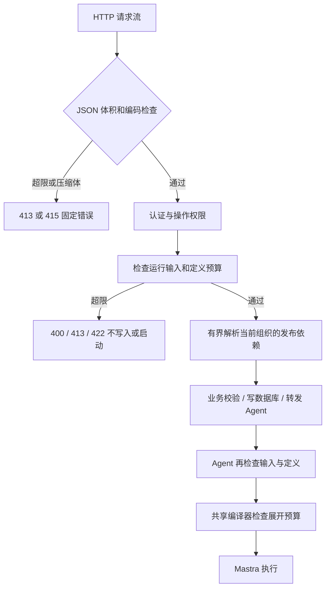
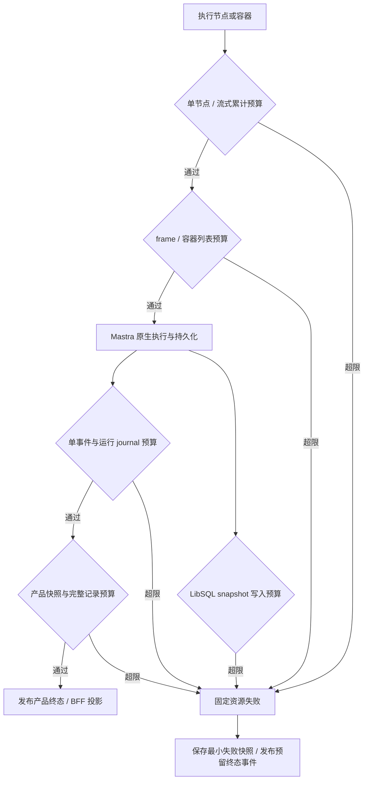

# Workflow 输入与运行资源边界

本页记录 M1-C 前两批交付：启动前限制输入与工作流展开规模，运行中限制输出、事件和快照。第三批已补齐当前单进程部署下的 [组织并发、请求频率与 SSE 连接限制](organization-resource-quotas.md)，以及 [草稿/模板写入审计](organization-authorization.md)。完整入口和部署验收仍待 M1-D，浏览器业务 API 保持关闭。

## 为什么需要提前检查

例如 Alice 提交一个工作流：外层 Iteration 最多运行 100 次，内部 Iteration 最多运行 100 次。即使定义只有几个节点，也可能执行上万次。子工作流被引用多次，也会带来多次执行，不能只按版本 ID 去重后计算成本。

原编译器已有节点数、预计步数等检查，但部分检查发生在递归校验或估算之后。若容器无限嵌套，服务可能先出现栈溢出；若先收集大量依赖再检查，就已经消耗了数据库和内存资源。这次把安全检查放到递归操作之前。

图中是逻辑检查位置。生产 SaaS 的身份白名单会更早拒绝尚未开放的业务路由；service 中的权限检查也独立保留，直接调用 service 不能跳过它。Agent 仍检查服务认证和可信租户上下文。HTTP 解析器检查实际收到的字节数，不依赖 `Content-Length`，所以 chunked 请求同样受限。

## 当前固定限制

| 对象 | 上限 | 检查位置 |
| --- | --- | --- |
| HTTP JSON 请求体、组装后的运行命令 | 2 MiB（2,097,152 字节） | BFF/Agent JSON 解析器及运行入口 |
| 单个 Workflow 定义、完整模板记录 | 1 MiB（1,048,576 字节） | 保存、导入、发布、模板与编译入口 |
| 展开的 Workflow 定义总大小 | 2 MiB | 每次展开子工作流都计入；容器内容已包含在所属定义中 |
| 运行 inputs、nodeInputs、审批数据 | 各 256 KiB（262,144 字节） | BFF service 和 Agent Runtime；BFF 完整审批请求也限 256 KiB |
| JSON 嵌套 | 64 层，根值深度为 0 | 非递归 JSON 遍历 |
| JSON 元素 | 100,000 | 单次 JSON 预算检查 |
| 展开后的节点、连边 | 200、400 | 包含容器和每次引用的子工作流 |
| 容器/子工作流深度 | 5 层 | 混合嵌套合并计数，根图深度为 0 |
| Iteration / Loop 最大次数 | 每个容器 1,000 | 配置必须为正安全整数 |
| Iteration 配置并发 | 10 | 仍受原 Runtime 并发约束 |
| 静态预计步数 | 1,000 | 内层步数乘所有外层迭代次数；保守估计 |

这些限制由服务端共享代码决定，请求不能覆盖，本地模式也执行。本轮不会自动修改或删除超限的历史数据；历史定义再次发布、转为草稿或运行时会重新检查。JSON 字节按转义后的 UTF-8 内容计算，中文、emoji、换行等也计入；不能用 JavaScript 字符数代替字节数。HTTP 限制针对收到的原始字节，service 限制针对解析后的 JSON 内容，空白因此只占 HTTP 预算。

JSON 请求体不接受压缩，返回 415，避免压缩体绕过传输体积限制。OIDC 使用的表单解析保留框架原配置；部署的反向代理还应设置相同或更严格的体积、速率和读取超时限制。

## 具体怎样实现

共享的 [JSON 预算检查](../packages/workflow-core/src/validation/json-budget.ts) 使用显式栈遍历，避免检查本身递归溢出。它同时累计字节数、值数量和深度，发现不合法 JSON 或循环引用就停止；错误中不包含原始输入。可选对象属性的 `undefined` 按 JSON 序列化语义省略，数组中的非 JSON 值则拒绝。

[定义预算检查](../packages/workflow-core/src/validation/resource-limits.ts) 再遍历图结构。根定义先通过 JSON 检查，容器继承所属定义的字节预算，子工作流使用业务层注入的只读版本解析器；BFF 解析器查询当前组织。每次展开都累计节点、连边、字节和预计步数，达到预算后停止，不先建立无限依赖闭包。递归引用最迟会触发深度限制，原发布校验仍保留递归依赖诊断。

预计步数包括容器自身。例如外层 100 次、内层 100 次、内层一个执行节点，仅执行节点就占 10,000 步，提交时即拒绝。静态预算会按配置的最大次数保守计算，即使实际输入只有一项也可能被拒绝；需要降低配置的最大次数，而非让服务临时放大预算。

[SOP service](../apps/bff/src/sops/sops.service.ts) 在创建、保存、导入、发布及模板写入之前检查，历史数据发布时也重新检查。v1 导入在迁移前后都检查，避免迁移生成更大的 v2 内容。[Workflow service](../apps/bff/src/workflow-runs/workflow-runs.service.ts) 在收集 Agent 依赖和访问上游前检查，审批也不能把数组或 `null` 静默替换成空对象。

[Agent Adapter](../apps/agent-cli/src/mastra/adapters/workflow-runtime-adapter.ts) 在创建运行前再次检查输入和定义，不能因为调用绕过 BFF 就失去限制。[共享编译器](../packages/workflow-core/src/compiler/compile.ts) 在归一化和递归校验前检查定义与依赖；既有语义、能力和资源估算校验继续保留。

## 超限后的结果与保证边界

| 情况 | HTTP 结果 |
| --- | --- |
| HTTP JSON 原始请求体超限 | `413 REQUEST_BODY_TOO_LARGE` |
| JSON 编码/语法错误，或不支持的压缩体 | 400 / 415，固定消息，不返回原文 |
| 定义/运行输入字节超限 | `413 WORKFLOW_RESOURCE_LIMIT` |
| JSON 形态无效或运行输入不是对象 | `400 WORKFLOW_RESOURCE_LIMIT` |
| 节点、深度、迭代次数、预计步数等超限 | `422 WORKFLOW_RESOURCE_LIMIT` |

写入前检查失败不改变草稿，启动前检查失败不创建运行，也不访问上游执行。发布仍可能记录一次失败的控制审计，这是操作留痕，不代表生成了版本。Runtime 直接调用失败后不占用运行 ID，之后有效命令可以正常运行。

运行中生成的数据按下面的另一组预算检查。静态步数预算不能替代运行超时、实际输出预算及租户配额。

## 运行中为什么还要设限

输入很小也可以生成大量输出。例如 Template 将 180 KB 的输入重复七次，输入检查通过，但输出超过 1 MiB。另一个例子是每步只产生几十 KB：Mastra 会保存各步骤的执行 frame，最终一条原生快照可能比最后一步 frame 大得多。因此，限制单节点不能替代限制累计状态和落库数据。

图中原生持久化和事件观察是执行过程中的两个边界，不表示跨数据库、JSON 文件和事件文件存在同一个事务。

### 输出与状态的固定上限

全部按 UTF-8 JSON 字节计数，共享定义位于 [output-budget.ts](../packages/workflow-core/src/validation/output-budget.ts)。JSON 深度及元素数量限制同样适用。

| 对象 | 上限 | 检查位置 |
| --- | --- | --- |
| 单节点输出、暂停 payload（提供时） | 1 MiB，且不超过 IR 的 `maxOutputBytes` | 执行器返回后、写入 frame 前；默认输出及错误路由也检查 |
| 单节点一次执行的流式数据与日志累计 | 1 MiB | 每次 emit 前检查；包含身份字段，跨重试累计 |
| 单个 frame | 2 MiB | Mastra typed step 的输入/输出 schema |
| Iteration / Parallel descriptors、results 列表 | 每个列表合计 2 MiB | schema 同时计算各项复制的 frame |
| 容器聚合结果、子工作流输出 | 1 MiB | Iteration、Loop、Parallel 与 Subworkflow 合并位置；包含结果字段包装及绑定字段前缀 |
| 产品运行快照 | 4 MiB | Agent 最终投影、运行仓库；BFF 接收快照及保存投影 |
| Agent 单条完整运行记录 | 8 MiB | 产品快照、IR 和恢复元数据一起检查；包括新增审批回执和保留期字段，不是整个 JSON 文件的大小 |
| Mastra 单条持久化 snapshot | 8 MiB | LibSQL BEFORE INSERT / UPDATE 触发器，覆盖 JSONB 原子 merge |
| 单条产品事件 | 1 MiB + 64 KiB（1,114,112 字节） | Mapper 去重前、Agent journal 和 BFF 事件保存前 |
| Agent 单 run 的 Workflow journal | 8 MiB 或 10,000 条，先到者生效 | 每个 run 串行检查，重启继承已用额度；字节包含换行 |
| 资源失败终态的预留事件 | 额外一条，JSON 不超过 1,024 字节 | 配额耗尽后仍可结束订阅；重复写入同一失败终态不新增 ID |
| BFF SSE 半包 / 完整 frame | 单事件预算 + 4 KiB 协议余量 | 分隔符缺失时也检查缓冲区，解析后再检查事件 JSON |

容器和 frame 的限制有意计算重复数据，不能按对象引用去重，否则序列化后仍会膨胀。Parallel 保留这些检查，但生产能力开关继续关闭。当前编译器的输出预算固定为 1 MiB，调用请求不能放大它。

### 超限后如何收敛

1. 运行返回固定错误码 `WORKFLOW_OUTPUT_LIMIT_EXCEEDED` 和固定消息，不把触发超限的输出放进错误。
2. 资源错误直接中止该执行路径，不能重试、走默认输出、走错误路由，或被容器的 `collect-errors` 当作普通业务错误收集。执行器捕获或包装 emit 错误，也不能把已触发的资源失败改成成功。
3. 原生完成不立即发布产品终态。Adapter 先检查最终快照、事件投影和完整记录；等待审批时先保存可恢复状态，再发布 waiting 事件。
4. 超限时先保存最小失败快照，再写预留的失败终态事件，订阅可正常结束。清除产品输出、节点输入/输出/错误正文、实例及子运行投影，保留运行身份、原始有界输入和最小节点状态。后续查询、BFF 投影及旧事件回放不会重新填充已清除的输出。
5. 被拒绝的 journal 事件不落盘、不通知、不占用 ID。已接受的有界历史事件仍保留，原生数据库拒绝超限更新时也保留上一条有效快照。资源失败清理产品投影，不代表删除所有运行历史。

HTTP 启动接受后才发生的输出超限体现为 **运行状态 failed**，不能用启动请求返回 413 表示。BFF 若收到超过快照预算的上游响应，会返回 `502 WORKFLOW_AGENT_RESPONSE_INVALID`，不保存该快照。SSE 已发送响应头后遇到畸形或超限上游帧，会终止连接；Agent 仍是运行状态的权威来源。

### 这批限制的保证范围

- 它们限制单次运行、单条记录及数据边界，不是进程内存、CPU、租户总存储或全库容量配额。组织未完成运行数、HTTP 频率和 SSE 连接数另由第三批限制，不能据此宣称整个数据库有容量上限。
- 数据库触发器仅用于固定版本 Mastra 的持久化 LibSQL。启动安装失败会使装配失败；升级 Mastra/存储结构时必须重新验证 INSERT、JSONB merge、重启及错误传播。非持久化 `InMemoryStore` 没有数据库触发器，仍执行节点、frame、事件和产品快照检查。
- 不自动删除已有大快照或历史运行；新写入受限。当前运行目录仍要求单 Agent 进程使用，不能让多个 Worker 共用 JSON/journal 来获得分布式配额。
- 超限停止继续接受数据，**不会回滚已经执行的外部副作用**，也不代表强制终止不响应取消的外部工具或模型。工具沙箱、上游取消、总消耗和队列治理分别在后续阶段验收。

## 验证入口

- [共享预算测试](../packages/workflow-core/test/unit/validation/resource-limits.test.ts)：UTF-8、精确字节边界、深嵌套、循环 JSON、总节点、乘积步数和依赖展开。
- [SOP 写入回归](../apps/bff/test/unit/sops/sops-resource-limits.test.ts)：超限不写入，历史数据发布重新检查。
- [Workflow 代理回归](../apps/bff/test/unit/workflow-runs/workflow-runs-resource-limits.test.ts)：输入/审批超限及递归依赖不访问 Agent。
- [BFF HTTP smoke](../apps/bff/test/smoke/workflow-resource-limits-api.test.ts)：真实服务接收超大、chunked、压缩请求，随后仍可正常创建与查询。
- [Agent Runtime 回归](../apps/agent-cli/test/unit/mastra/adapters/workflow-runtime-adapter.test.ts)与[Agent HTTP smoke](../apps/agent-cli/test/smoke/nest-host-compatibility.test.ts)：直接入口拒绝及拒绝后恢复。
- [输出与终态回归](../apps/agent-cli/test/unit/mastra/adapters/workflow-runtime-adapter.test.ts)：超大节点、流式累计、执行器包装异常、journal 耗尽、原生快照累积、失败查询与重建。
- [事件 journal 回归](../apps/agent-cli/test/unit/mastra/storage/event-journal.test.ts)：字节/条数、并发、重启与预留失败事件。
- [原生数据库回归](../apps/agent-cli/test/unit/mastra/storage/workflow-snapshot-budget.test.ts)：真实 LibSQL INSERT / JSONB 更新被拒绝、旧行保留、重启后限制仍生效。
- [BFF 投影回归](../apps/bff/test/unit/workflow-runs/sqlite-workflow-runs.repository.test.ts)与[SSE 解码回归](../apps/bff/test/unit/workflow-runs/sse-decoder.test.ts)：超限回滚、不重新灌入失败输出、无分隔符缓冲受限。
- [真实 Agent 进程 smoke](../apps/bff/test/smoke/runtime-tenant-boundary.test.ts)：BFF 代理通过 HTTP 启动合法输入生成的超限输出，查询与 SSE 返回失败，重启可回放，后续正常运行成功；不调用收费模型，不替代完整 IdP 入口验证。

继续执行范围见 [Server 开发路线](server-development-roadmap.md#m1-c补齐开放前的输入与资源边界)。
